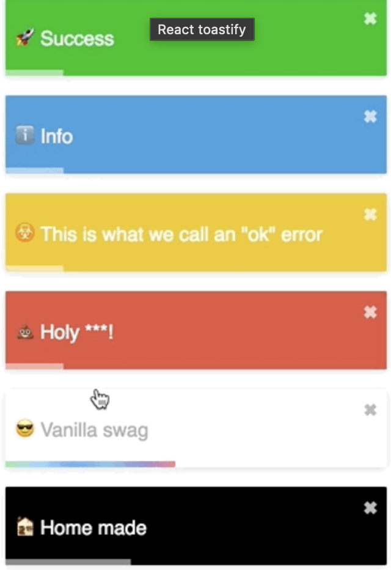
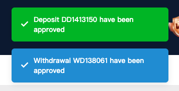

# 吐司通知發送器

-   這個模組提供了一個靈活的方法來發送各類型的吐司通知。透過 react-toastify 7.0.4 版實現，支持多種預設樣式和自定義圖標選項，以適應不同的使用情境。

# react-toastify 7.0.4 舊版無官方教學文件，但有參考 gif 圖片，可以參考以下連結：

-   https://www.npmjs.com/package/react-toastify/v/7.0.4

## 功能特點

-   支持四種預定義的吐司類型：成功（綠色）、錯誤（紅色）、資訊（藍色）、警告（黃色）。
-   提供可選的聲音通知功能。
-   使用預設顏色樣式，簡化配置，避免額外的樣式定制。

### ＝＝＝＝＝＝＝＝＝＝＝＝＝＝＝＝＝＝＝＝＝＝＝＝＝＝＝＝＝＝＝＝＝

### 預設吐司訊息，舊版吐司訊息沒有預設 icon - example

```tsx
import { ToastEmitter, ToastTypeEnum } from "@/path/to/ToastEmitter";

// 發送一個成功通知
ToastEmitter({
	message: "hello world",
	backgroundColor: ToastTypeEnum.Success // 在舊版本中，由於缺少預設 icon，所以各類型間只有背景色有差異，我們可以利用 ToastBGColorEnum 來設定吐司訊息的類型，並根據類型使用對應的預設背景顏色：Success（綠色）、Error（紅色）、Info（藍色）、Warning（黃色）。
});
```

### 範例圖片



### ＝＝＝＝＝＝＝＝＝＝＝＝＝＝＝＝＝＝＝＝＝＝＝＝＝＝＝＝＝＝＝＝＝

### 自定義帶圖標的吐司訊息，可以傳送 iconClassName 參數，讓吐司訊息帶有 icon - example

```tsx
// 提供一些預設的自定義樣式 Enum 供直接使用，也允許開發者自行新增， 以避免因各開發者個人 codeing 風格而導致樣式混亂。
import {
	ToastEmitter,
	ToastBGColorEnum,
	ToastIconEnum
} from "@ailab-desktop/components";

ToastEmitter({
	message: "hello world",
	customBGColor: ToastBGColorEnum.Green, // 在舊版本中，由於缺少預設 icon，所以各類型間只有背景色有差異，可以利用 ToastBGColorEnum 來設定吐司訊息的類型，並根據類型使用對應的預設背景顏色：Success（綠色）、Error（紅色）、Info（藍色）、Warning（黃色）。
	customIconClassName: ToastIconEnum.Checkmark // 使用自定義的 icon className，如需其他 icon，請通知設計，更新 css 將其添加到專案中。
});
```

### 自定義 icon 跟 背景色，範例圖片 ( 範例圖片使用於存提款成功 )


